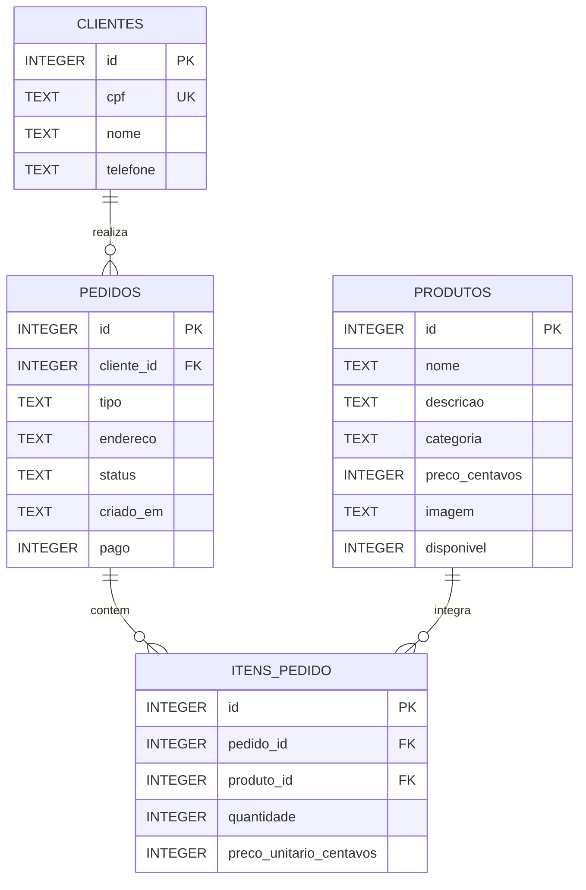

# DER — Esquina do Sabor

**Projeto Final +TI | Banco SQLite (`banco.db`)**

Este documento apresenta o **Diagrama Entidade-Relacionamento (DER)** correspondente às quatro tabelas do banco de dados do projeto *Esquina do Sabor*.

As entidades do diagrama usam nomes em maiúsculas para apresentação: `CLIENTES`, `PRODUTOS`, `PEDIDOS` e `ITENS_PEDIDO` correspondem às tabelas `clientes`, `produtos`, `pedidos` e `itens_pedido` de `banco.db`. Os campos e relacionamentos abaixo foram comparados com a estrutura existente; não é necessário criar novas tabelas ou chaves estrangeiras.

## 1. Diagrama Entidade-Relacionamento

> **Como visualizar:** em um editor Markdown com suporte a **Mermaid** (por exemplo, na pré-visualização do Markdown do GitHub ou do VS Code com suporte ao Mermaid), o código abaixo aparece como um diagrama.



**Legenda:**

- **PK** — chave primária (*Primary Key*).
- **FK** — chave estrangeira (*Foreign Key*).
- **UK** — valor único (*Unique Key*).
- **1:N** — uma ocorrência da primeira entidade pode se relacionar com várias ocorrências da segunda.
- **`||--o{`** — um registro da entidade à esquerda se relaciona com **zero ou muitos** registros da entidade à direita; cada registro à direita pertence a **exatamente um** à esquerda.

## 2. Relacionamentos

| Entidades | Cardinalidade | Descrição |
|---|---|---|
| `clientes` → `pedidos` | 1:N | Cada pedido pertence a um cliente; um cliente pode ter vários pedidos. |
| `pedidos` → `itens_pedido` | 1:N | Cada item pertence a um pedido; um pedido pode reunir vários itens. |
| `produtos` → `itens_pedido` | 1:N | Cada item faz referência a um produto; o mesmo produto pode aparecer em pedidos diferentes. |

### Associação com as chaves do banco

| Entidade principal e sua PK | Tabela que guarda a FK | Restrição existente | Exclusão do registro principal |
|---|---|---|---|
| `clientes.id` | `pedidos.cliente_id` | `NOT NULL`, referencia `clientes(id)` | `ON DELETE RESTRICT` |
| `pedidos.id` | `itens_pedido.pedido_id` | `NOT NULL`, referencia `pedidos(id)` | `ON DELETE CASCADE` |
| `produtos.id` | `itens_pedido.produto_id` | `NOT NULL`, referencia `produtos(id)` | `ON DELETE RESTRICT` |

O lado **zero ou muitos** descreve quantos registros associados o registro principal pode ter: um cliente pode ainda não ter pedidos e um pedido pode ainda não ter itens. Isso não torna a FK opcional: cada pedido exige um cliente, e cada item exige um pedido e um produto, pois as três FKs são `NOT NULL`.

As verificações dos vínculos exigem `PRAGMA foreign_keys = ON` na conexão. Essa configuração já é usada pelos exemplos de escrita. `RESTRICT` bloqueia a exclusão do registro principal quando há referências; `CASCADE` exclui os itens ao excluir seu pedido.

**Observação:** o relacionamento entre `pedidos` e `produtos` é de **muitos para muitos (N:N)**, resolvido pela tabela intermediária `itens_pedido`.

A tabela intermediária possui sua própria PK, `id`. O par (`pedido_id`, `produto_id`) tem uma restrição `UNIQUE` composta: a combinação é única, mas cada uma dessas FKs pode se repetir separadamente. A quantidade e o preço unitário são atributos dessa associação.

### Exemplo de consulta usando as associações

Os `JOIN` abaixo percorrem as três chaves estrangeiras do diagrama. O nome do cliente e do produto são consultados nas respectivas tabelas; o preço usado é o registrado no item.

```sql
SELECT p.id AS pedido_id, c.nome AS cliente, pr.nome AS produto,
       i.quantidade, i.preco_unitario_centavos,
       i.quantidade * i.preco_unitario_centavos AS subtotal_centavos
FROM pedidos AS p
JOIN clientes AS c ON c.id = p.cliente_id
JOIN itens_pedido AS i ON i.pedido_id = p.id
JOIN produtos AS pr ON pr.id = i.produto_id
ORDER BY p.id, i.id;
```

Como a consulta utiliza `JOIN`, ela mostra pedidos que têm itens. Para incluir pedidos sem itens, use `LEFT JOIN`, como na consulta de totais do [README do banco](README.md#consultas-para-estudar).

## 3. Campos das tabelas

### `clientes`

| Campo | Tipo SQLite | Regra |
|---|---|---|
| `id` | INTEGER | PK, autoincremento |
| `cpf` | TEXT | Obrigatório, único e com 11 dígitos numéricos |
| `nome` | TEXT | Obrigatório, não vazio |
| `telefone` | TEXT | Obrigatório, não vazio |

### `produtos`

| Campo | Tipo SQLite | Regra |
|---|---|---|
| `id` | INTEGER | PK, autoincremento |
| `nome` | TEXT | Obrigatório, não vazio |
| `descricao` | TEXT | Opcional |
| `categoria` | TEXT | Obrigatório, não vazio |
| `preco_centavos` | INTEGER | Obrigatório, maior ou igual a zero |
| `imagem` | TEXT | Opcional; caminho para a imagem |
| `disponivel` | INTEGER | `1` = disponível; `0` = indisponível; padrão `1` |

### `pedidos`

| Campo | Tipo SQLite | Regra |
|---|---|---|
| `id` | INTEGER | PK, autoincremento |
| `cliente_id` | INTEGER | FK → `clientes.id`, obrigatório |
| `tipo` | TEXT | `local`, `retirada` ou `entrega` |
| `endereco` | TEXT | Obrigatório quando `tipo = 'entrega'` |
| `status` | TEXT | `recebido`, `em_preparo`, `pronto`, `concluido` ou `cancelado`; padrão `recebido` |
| `criado_em` | TEXT | Data/hora de criação; padrão `CURRENT_TIMESTAMP` |
| `pago` | INTEGER | `0` = não pago; `1` = pago; padrão `0` |

### `itens_pedido`

| Campo | Tipo SQLite | Regra |
|---|---|---|
| `id` | INTEGER | PK, autoincremento |
| `pedido_id` | INTEGER | FK → `pedidos.id`, obrigatório |
| `produto_id` | INTEGER | FK → `produtos.id`, obrigatório |
| `quantidade` | INTEGER | Obrigatório, maior que zero |
| `preco_unitario_centavos` | INTEGER | Obrigatório, maior ou igual a zero; registra o valor no momento do pedido |

**Regra adicional:** o par (`pedido_id`, `produto_id`) é único: dentro de um mesmo pedido, a quantidade do mesmo produto fica acumulada em uma única linha.

## 4. Regras de integridade

### Regras existentes no banco

- Um pedido não pode apontar para um cliente inexistente.
- Um item não pode apontar para um pedido ou produto inexistente.
- Ao excluir um pedido, seus itens são excluídos junto com ele (`ON DELETE CASCADE`).
- Um cliente ou produto que já esteja referenciado não pode ser excluído diretamente (`ON DELETE RESTRICT`).
- Um pedido de entrega precisa ter endereço preenchido.
- Um pedido cancelado não pode estar marcado como pago no modelo atual.
- O banco verifica o formato do CPF (11 dígitos), **não** seus dígitos verificadores.

### Regras que dependem da aplicação

O banco permite criar um pedido ainda sem itens, não verifica `produtos.disponivel` ao inserir um item e não impede alterações apenas porque um pedido está concluído. Se o escopo exigir essas verificações, elas precisam ser implementadas no backend; o DER não significa que já estejam implementadas.

A mesma distinção vale para a validação matemática do CPF e para uma sequência obrigatória de mudanças de status. O esquema atual não impõe essas regras. A simulação do exemplo `05-querystring.js` já consulta a disponibilidade e o preço do produto, mas não grava pedidos nem seus itens.

## 5. Cálculo da conta

O valor de cada pedido é calculado a partir de seus itens, sem necessidade de uma coluna `total`:

```sql
SELECT
    pedido_id,
    SUM(quantidade * preco_unitario_centavos) / 100.0 AS total_reais
FROM itens_pedido
WHERE pedido_id = 1
GROUP BY pedido_id;
```

O id `1` é apenas um exemplo. Use um id existente ao consultar um pedido específico. Se o pedido não tiver itens, essa consulta não retorna linhas; a versão com `LEFT JOIN` e `COALESCE` no README também inclui pedidos sem itens, com total zero.

Os preços são armazenados em **centavos inteiros**, evitando problemas de precisão com valores monetários.

---

**Compatibilidade:** este DER foi conferido com as quatro tabelas, os 23 campos, as três chaves estrangeiras e as restrições de unicidade do arquivo SQLite `banco.db`. A inspeção com `PRAGMA foreign_key_check` não encontrou vínculos inválidos nos registros existentes. A tabela interna `sqlite_sequence` não faz parte das entidades do restaurante.

Consulte o [README do banco](README.md) para a explicação dos campos e o [roteiro de prática](../exemplos/ROTEIRO.md) para executar os exemplos.
